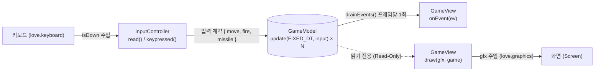

# 4일차(4주차) 학습 보고서 — 겔러그 MVC: View·Controller 연결, 헤드리스 검증 및 번짐 실측

> **학습 주제:** 3주차 순수 Model을 한 글자도 수정하지 않고 View·Controller를 조립하여 게임을 완성하고, 창 없는 헤드리스 테스트 및 기능 추가 시 수정 번짐(Ripple)을 2주차 모놀리식과 정량 비교한다.  
> **대상 디렉터리:** [`lua_tuto/mvc/week04/`](README.md)

---

## 1. 학습 목표 및 핵심 요약

1. **의존성 주입(DI)을 통한 엔진 격리:** View에 `love.graphics`(`gfx`)를, Controller에 `love.keyboard.isDown`(`isDown`)을 주입받아 `love.*` 전역 호출을 제거하고 창 없이 테스트한다.
2. **조립부(Composition Root) 역할 이해:** `main.lua`가 M·V·C를 생성 및 연결하고, 한 프레임의 실행 순서(`C → M 고정 스텝 → drainEvents → V`)를 제어한다.
3. **계층 규칙과 무상태성 검증:** 정적 계층 검사(`layer_check`)와 스냅숏 비교(`snapshot/same`)를 통해 View가 Model을 변경하지 않음을 증명한다.
4. **모놀리식 vs MVC 정량 비교:** 유도 미사일과 보스 탄막 추가 시 수정 범위(hunk)를 실측하고, MVC가 **해결한 것**과 **해결하지 못한 것**을 객관적으로 분석한다.

---

## 2. 한 프레임의 데이터 흐름 및 아키텍처



### 2-1. `main.lua`의 표준 프레임 루프 순서
```lua
-- 1) Controller: 프레임당 1회 입력 스냅샷 수집
local input = controller:read()

-- 2) Model: 고정 타임스텝(FIXED_DT) 누적 실행 (0~N회)
acc = acc + math.min(dt, MAX_FRAME_DT) -- Spiral of Death 방지 (0.25s 상한)
while acc >= FIXED_DT do
  game:update(FIXED_DT, input)
  acc = acc - FIXED_DT
end

-- 3) M → V: 반복문 밖에서 프레임당 1회 이벤트 소비
for _, ev in ipairs(game:drainEvents()) do
  view:onEvent(ev)
end

-- 4) View: 파티클, 흔들림 등 연출 시간 진행
view:update(dt)
```

### 2-2. 계층별 엄격한 규칙
| 계층 | 담당 역할 | 금지 사항 (`layer_check.lua` 검사 대상) |
| :--- | :--- | :--- |
| **Model** (`models/`) | 상태 보관, 물리/충돌 규칙, 이벤트 발행 | `print()`, `io.*`, `love.*` 전면 금지 (3주차 원본과 바이트 동일) |
| **View** (`views/`) | Model 읽기 전용 참조, 연출 상태 관리, 주입받은 `gfx`로 그리기 | `love.*` 직접 호출 금지, Model 상태 변경 금지, Controller `require` 금지 |
| **Controller** (`controllers/`) | 주입받은 `isDown` 해석, 입력 계약 생성, Model 명령 호출 | `love.*` 직접 호출 금지 (`love.event.quit()` 대신 `"quit"` 문자열 반환), View `require` 금지 |
| **Main** (`main.lua`) | `setRequirePath` 설정, 난수 시드 지정, M·V·C 생성 및 연결 | 게임 규칙, 화면 그리기 문구, 키 배치 해석 금지 |

---

## 3. 창 없는 헤드리스(Headless) 테스트 기법 및 실측 결과

LÖVE2D 창을 띄우지 않고 순수 `lua` / `luajit` CLI 환경에서 View와 Controller를 검증하는 핵심 기법들이다.

### 3-1. 주요 테스트 기법
- **가짜 `gfx` (Spy/호출 기록기, `helper.fakeGfx()`):** `rectangle`, `print`, `push`/`pop` 호출 횟수와 인자를 기록해 화면 없이도 "무엇을 몇 번 그렸는지" 검증한다.
- **스냅숏 비교 (`helper.snapshot` / `same`):** `draw()`, `onEvent()`, `update()` 전후의 Model 전체 상태를 깊은 복사해 비교함으로써 View가 Model을 단 한 글자라도 수정하면 바뀐 경로(예: `game.score`)를 즉시 지목한다.
- **가짜 `isDown`:** 키 입력 조합을 함수로 주입해 이동 상쇄(`←`+`→` = 0), A/D 키 매핑, 게임오버 시 R 키 리셋 등을 검증한다.
- **고정 타임스텝 & 특성(Characterization) 테스트:** 입력이 일정할 때 60fps와 20fps 결과가 완전히 동일함을 검증하고, 동시에 키 입력 변화 시 프레임 경계 반올림으로 인해 결과가 달라지는 한계(예: 0.31초에 키 해제 시 `x = 381.3` vs `392.0`)를 명문화한다.

### 3-2. 테스트 스위트 실행 결과 (완성본 검증)
`lua_tuto/mvc/week04/examples/tests/` 경로에서 실행한 결과:

| 테스트 파일 | 검증 대상 | 실행 결과 | 비고 |
| :--- | :--- | :---: | :--- |
| `layer_check.lua` | `galaga_mvc/` 13개 파일 계층·금지 API | **위반 0건 (OK)** | `love`, `io`, `print` 및 역참조 차단 |
| `controller_test.lua` | 키 매핑, C→M 연결, `"quit"` 신호 | **9 통과 / 0 실패** | `InputController` 독립 검증 |
| `view_test.lua` | Model 불변성, 그리기 수량, 파티클/흔들림 | **9 통과 / 0 실패** | 모르는 이벤트 무시, `push/pop` 짝 검증 |
| `integration_test.lua` | 60fps vs 20fps 결정성, 스텝 누적 이벤트 | **5 통과 / 0 실패** | 입력 변화 반올림 한계 특성 테스트 포함 |
| `feature_test.lua` | 유도 미사일 + 보스 탄막 + 번짐 방지 | **14 통과 / 0 실패** | `galaga_mvc_full/` 전용 검증 |

> **참고 (빈 코드 통과 함정):** "View가 Model을 바꾸지 않는다" 같은 **금지 테스트**는 본문이 비어 있는 코드도 통과해 버린다. 따라서 반드시 "적 수만큼 사각형을 그린다" 같은 **기능 테스트**와 짝을 이뤄 작성해야 의미가 있다.

---

## 4. 수정 번짐(Ripple) 실측 비교: 2주차 모놀리식 vs 4주차 MVC

동일한 두 기능(**유도 미사일 + 보스 원형 탄막**)을 추가했을 때 코드가 얼마나 퍼지는지 `diff`로 실측 비교한 결과다.

| 비교 지표 | 2주차 모놀리식 (`galaga_monolith_full`) | 4주차 MVC (`galaga_mvc_full`) |
| :--- | :--- | :--- |
| **수정한 기존 파일 수** | 1개 (`main.lua` 전체) | 8개 (이 중 `conf`, `main`, `BulletModel` 3개는 주석/창제목만 수정) |
| **새로 추가한 파일 수** | 0개 (단일 파일에 혼합) | 3개 (`BossModel.lua` 69줄, `homing.lua` 39줄, `BossView.lua` 21줄) |
| **변경 블록(hunk) 수** | **41곳** (단일 파일 전역에 산재) | **25곳** (`GameModel` 12 · `InputController` 5 · `BulletView` 2 · `GameView` 2 · `HudView` 1 · 기타 3) |
| **증감 라인 수** | +176 / −38줄 (280 → 418줄) | 기존 +107 / −10줄, 신규 +129줄 (총 +236줄) |
| **전혀 건드리지 않은 코드** | **없음** (일반 적 총알 로직까지 오염됨) | `PlayerModel`, `EnemyModel`, `EffectsView`, `PlayerView`, `EnemyView` (0줄 수정) |
| **기존 기능 회귀 검증** | 불가능 (눈으로 수동 플레이만 가능) | 기존 37개 테스트(모델 14 + MVC 23) **100% 자동 통과** |

### 정직한 아키텍처 해석
- **✅ MVC가 해결한 것**
  1. **무관한 코드로의 번짐 차단:** 2주차에서는 보스 탄막 때문에 일반 적 총알 생성·이동 코드까지 깨졌으나, 4주차는 `BulletModel`의 `vx/vy` 계약을 그대로 재사용하고 `EffectsView`도 0줄 수정으로 버텼다.
  2. **수정 위치의 예측 가능성:** 로직은 `models/`, 그리기는 `views/`, 키 바인딩은 `controllers/`로 수정 범위가 격리되었다.
  3. **신속한 회귀 검증:** 변경 후 1초 이내에 기존 37개 + 신규 14개 테스트로 안전성을 확신할 수 있다.
- **⚠️ MVC가 해결하지 못한 것 (다음 주 과제)**
  1. **총 코드량 증가:** 인터페이스를 나누고 조립 코드를 작성하면서 전체 줄 수는 오히려 늘었다(236 vs 176). MVC는 코드를 줄이는 기법이 아니라 **변경을 가두는 기법**이다.
  2. **`GameModel`으로의 변경 집중:** 전체 25개 변경 블록 중 12개가 조율자(Orchestrator)인 `GameModel`에 몰렸다. 보스전과 일반 웨이브가 섞이며 비대해지는 문제는 **5주차 State 패턴(상태/씬 분리)**과 **6주차 Store/이벤트 버스**로 다시 분리해야 해결된다.

---

## 5. 실습 시 주의할 흔한 실수 (Checklist)

| 흔한 실수 | 발생하는 문제 | 올바른 해결 방법 |
| :--- | :--- | :--- |
| `drainEvents()`를 호출하지 않음 | 폭발/흔들림 연출이 안 나오고 이벤트 큐가 무한 누적됨 | `while` 물리 루프 밖에서 프레임당 1회 비워 View에 전달 |
| `input` 테이블을 Model에 그대로 저장 | `InputController:read()`가 GC 방지를 위해 테이블을 재사용하므로 다음 프레임에 값이 덮어써짐 | 필요한 값(`move`, `fire`)만 추출해 사용하거나 복사 |
| `GameView:draw`에서 `pop()` 전에 HUD 그리기 | 피격 시 화면 흔들림(`translate`)이 점수판(HUD)까지 같이 흔들어버림 | 월드 객체만 `push/translate/pop` 안에서 그리고 HUD는 `pop` 이후에 출력 |
| `setRequirePath`를 `love.load` 안에 배치 | 파일 최상단의 `require`가 먼저 실행되어 `models/` 모듈을 찾지 못함 | `main.lua` 파일 최상단에 경로 등록 코드 배치 |
| `draw()` 안에서 `math.random()` 호출 | 그리기 함수가 전역 난수 상태를 오염시켜 재현성/디버깅 훼손 | 흔들림 오프셋 등 난수 계산은 `view:update(dt)`에서 완료 후 `draw`는 읽기만 수행 |

---

## 6. 핵심 개념 퀴즈 및 정리

1. **View가 `love.graphics`를 직접 부르지 않고 주입받는 이유 (테스트 관점)**  
   - 직접 호출하면 `love` 런타임이 없는 CLI 환경에서 실행조차 불가능하다. `gfx`를 주입받으면 테스트에서 가짜 `gfx`(호출 기록기)를 넣어 **창 없이도 무엇을 몇 번 그렸는지 기록·검사**할 수 있다.
2. **프레임당 `controller:read()` 1회가 보장하는 것과 보장하지 못하는 것**  
   - **보장:** 입력이 일정하게 유지되는 구간에서는 프레임률(60fps vs 20fps)과 무관하게 동일한 물리 결과를 낸다.  
   - **보장 못 함:** 플레이어가 키를 누르거나 떼는 전환 순간은 프레임 경계로 반올림되므로, 프레임률이 다르면 경계 오차가 발생할 수 있다.
3. **연출 난수는 View에 있어도 되지만, 적 발사 난수는 Model의 주입 RNG여야 하는 이유**  
   - 파티클 방향 등의 연출 난수는 게임 규칙(점수, 승패, 충돌)에 영향을 주지 않아 비결정적이어도 무방하다. 반면 적 발사 위치·타이밍은 게임 승패를 좌우하므로 테스트와 리플레이의 결정성을 위해 반드시 주입된 RNG를 써야 한다.
4. **`view_test`의 "draw는 Model을 바꾸지 않는다"와 짝을 이루어야 하는 테스트**  
   - 금지 테스트만으로는 아무것도 안 하는 빈 함수도 통과하므로, "살아있는 적 수만큼 사각형을 그린다", "HUD가 점수를 출력한다" 같은 **기능 테스트**가 반드시 함께 있어야 한다.
5. **MVC가 해결하지 못한 두 가지와 다음 주차의 해결책**  
   - ① 전체 코드량 증가 ② 조율자인 `GameModel`로의 변경 집중 → **5주차(State 패턴으로 보스전·씬 분리)** 및 **6주차(중앙 Store/이벤트 아키텍처)**에서 해결한다.

---

## 7. 4항목 회고 루브릭 (2주차 vs 4주차 비교)

| 평가 항목 | 2주차 모놀리식 | 4주차 MVC | 근거 |
| :--- | :---: | :---: | :--- |
| **가독성·유지보수** | 1점 | **4점** | 파일 이름만으로 책임 파악 가능, 무관한 파일 5개 0줄 수정 |
| **디버깅 용이성** | 1점 | **5점** | `view_test` 스냅숏이 상태 변경 경로(`game.score`)를 정확히 지목 |
| **테스트 가능성** | 1점 | **5점** | 창 없이 0.1초 내에 37개+ 헤드리스 자동 테스트 통과 |
| **AI 컨텍스트 밀도** | 2점 | **5점** | 프롬프트에 특정 1~2개 파일만 지정해도 정확한 수정 가능 |

