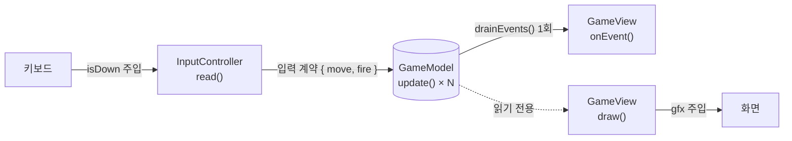

# 4주차 발표 자료 — starter TODO 정답 및 아키텍처 해설

> **대상 파일:**  
> - [`starter/views/EnemyView.lua`](views/EnemyView.lua)  
> - [`starter/views/BulletView.lua`](views/BulletView.lua)  
> - [`starter/views/HudView.lua`](views/HudView.lua)  
> - [`starter/views/EffectsView.lua`](views/EffectsView.lua)  
> - [`starter/views/GameView.lua`](views/GameView.lua)  
> - [`starter/controllers/InputController.lua`](controllers/InputController.lua)  
> - [`starter/main.lua`](main.lua)

---

## 🎯 발표 도입: 4주차 실습의 핵심 목표

> **발표 멘트 포인트:**  
> *"3주차에 만든 순수 Model을 **단 한 글자도 고치지 않고**, View와 Controller를 연결하여 게임을 완성했습니다. 핵심은 `love.graphics`와 `love.keyboard`를 **직접 호출하지 않고 주입받아** 창 없는 헤드리스 환경에서 View와 Controller를 100% 자동 검증할 수 있게 만든 점입니다."*



---

## 1. View 계층 TODO 정답 & 해설

### ① [`views/EnemyView.lua`](views/EnemyView.lua)
> `-- TODO: 색을 정하고, alive 인 적만 gfx.rectangle("fill", x, y, w, h)`

- **정답 코드:**
  ```lua
  function EnemyView.draw(gfx, enemies)
    -- TODO: 색을 정하고, alive 인 적만 gfx.rectangle("fill", x, y, w, h)
    --       ⚠️ e.alive = ... 처럼 쓰는 순간 view_test 의 "읽기 전용" 검사가 잡아낸다.
    gfx.setColor(COLOR[1], COLOR[2], COLOR[3])
    for i = 1, #enemies do
      local e = enemies[i]
      if e.alive then
        gfx.rectangle("fill", e.x, e.y, e.w, e.h)
      end
    end
  end
  ```
- **발표 해설:**
  - `e.alive`가 `true`인 적만 화면에 렌더링합니다.
  - **⚠️ 읽기 전용 약속:** 만약 View 안에서 실수로 `e.alive = false` 같은 쓰기 코드를 넣으면, `view_test.lua`의 스냅숏 검사가 상태 오염을 즉시 감지해 실패합니다.

---

### ② [`views/BulletView.lua`](views/BulletView.lua)
> `-- TODO: 플레이어 총알(PLAYER_COLOR), 적 총알(ENEMY_COLOR) 을 각각 사각형으로`

- **정답 코드:**
  ```lua
  local function drawAll(gfx, list)
    for i = 1, #list do
      local b = list[i]
      gfx.rectangle("fill", b.x, b.y, b.w, b.h)
    end
  end

  function BulletView.draw(gfx, bullets, enemyBullets)
    -- TODO: 플레이어 총알(PLAYER_COLOR), 적 총알(ENEMY_COLOR) 을 각각 사각형으로
    gfx.setColor(PLAYER_COLOR[1], PLAYER_COLOR[2], PLAYER_COLOR[3])
    drawAll(gfx, bullets)
    gfx.setColor(ENEMY_COLOR[1], ENEMY_COLOR[2], ENEMY_COLOR[3])
    drawAll(gfx, enemyBullets)
  end
  ```
- **발표 해설:**
  - 플레이어 총알과 적 총알의 사각형 렌더 루프를 `drawAll()` 헬퍼 함수로 묶어 중복 코드를 제거했습니다.
  - 각각 고유 색상(`PLAYER_COLOR`, `ENEMY_COLOR`)을 설정하여 시각적으로 쉽게 구분되도록 했습니다.

---

### ③ [`views/HudView.lua`](views/HudView.lua)
> `-- TODO: gfx.print("SCORE " .. game.score, 10, 10)`  
> `--       gfx.print("LIVES " .. game.lives, width - 100, 10)`  
> `--       state == "gameover" 이면 가운데에 "GAME OVER\nPress R" (gfx.printf)`

- **정답 코드:**
  ```lua
  function HudView.draw(gfx, game, width, height)
    -- TODO: gfx.print("SCORE " .. game.score, 10, 10)
    --       gfx.print("LIVES " .. game.lives, width - 100, 10)
    --       state == "gameover" 이면 가운데에 "GAME OVER\nPress R" (gfx.printf)
    gfx.setColor(1, 1, 1)
    gfx.print("SCORE " .. game.score, 10, 10)
    gfx.print("LIVES " .. game.lives, width - 100, 10)
    if game.state == "gameover" then
      gfx.printf("GAME OVER\nPress R", 0, height * 0.475, width, "center")
    end
  end
  ```
- **발표 해설:**
  - 점수와 남은 라이프를 좌상단/우상단에 표시하고, 게임오버 시 안내 문구를 중앙에 출력합니다.
  - 고정 좌표(`500`) 대신 `width - 100`, `height * 0.475`를 사용하여 해상도 변경에도 유연하게 대처합니다.

---

### ④ [`views/EffectsView.lua`](views/EffectsView.lua)
> `-- STARTER TODO: 이벤트 종류별로 연출을 켠다. (2주차 explode()·screenShake 가 하던 일)`

- **정답 코드:**
  ```lua
  function EffectsView:onEvent(ev)
    -- TODO
    if ev.type == "enemy_destroyed" then
      self:_burst(ev.x, ev.y)
      self.flash = FLASH_TIME
    elseif ev.type == "player_hit" then
      self.shake = SHAKE_TIME
    elseif ev.type == "formation_cleared" then
      self.banner = BANNER_TIME
    end
  end
  ```
- **발표 해설:**
  - 2주차 모놀리식의 물리 루프에 박혀 있던 `explode()`와 `screenShake`를 View로 완전히 격리했습니다.
  - **모르는 이벤트 무시:** `if-elseif`에 해당하지 않는 이벤트(예: 4주차 후반의 `boss_hit` 등)가 Model에서 추가되어도 View 코드가 에러를 내지 않고 조용히 넘어가므로, Model의 변경에 View가 깨지지 않습니다.

---

### ⑤ [`views/GameView.lua`](views/GameView.lua)
> `-- TODO: 그리는 순서가 곧 겹침 순서다.`

- **정답 코드:**
  ```lua
  function GameView:draw(gfx, game)
    -- TODO: 그리는 순서가 곧 겹침 순서다.
    --   1) gfx.push(); gfx.translate(흔들림 ox, oy)      ← 월드만 흔든다
    --   2) 번쩍임 → 플레이어 → 적 → 총알 → 파티클
    --   3) gfx.pop()                                     ← push/pop 짝이 맞아야 한다
    --   4) HUD → 배너                                    ← HUD 는 흔들리지 않는다
    local fx = self.effects
    gfx.push()
    gfx.translate(fx.ox, fx.oy)
    fx:drawFlash(gfx, self.width, self.height)
    PlayerView.draw(gfx, game.player)
    EnemyView.draw(gfx, game.enemies)
    BulletView.draw(gfx, game.bullets, game.enemyBullets)
    fx:drawParticles(gfx)
    gfx.pop()

    HudView.draw(gfx, game, self.width, self.height)
    fx:drawBanner(gfx, self.width, self.height)
  end
  ```
- **발표 해설:**
  - **합성 뷰(Composite View):** 여러 하위 View들을 한곳에 조립하여 화면 전체를 그립니다.
  - **`push/pop` 격리:** 화면 흔들림(`translate`)을 월드 객체(배경, 플레이어, 적, 총알, 파티클)에만 적용하고, `pop()` 이후에 `HudView`를 호출하여 점수판과 UI는 화면 진동에 영향받지 않도록 고정했습니다.

---

## 2. Controller 계층 TODO 정답 & 해설

### ⑥ [`controllers/InputController.lua`](controllers/InputController.lua)
> `-- TODO: self.keys.left 중 하나라도 눌리면 -1, right 면 +1 (둘 다면 0)`  
> `-- TODO: quit 키 → "quit" 반환 (종료 자체는 main 이 한다 — 왜?)`

- **정답 코드:**
  ```lua
  local function anyDown(isDown, list)
    for i = 1, #list do
      if isDown(list[i]) then
        return true
      end
    end
    return false
  end

  function InputController:read()
    -- TODO: self.keys.left 중 하나라도 눌리면 -1, right 면 +1 (둘 다면 0)
    --       fire 키가 눌렸는지. 결과를 self.input 에 채워 돌려준다.
    local move = 0
    if anyDown(self.isDown, self.keys.left) then
      move = move - 1
    end
    if anyDown(self.isDown, self.keys.right) then
      move = move + 1
    end
    self.input.move = move
    self.input.fire = anyDown(self.isDown, self.keys.fire)
    return self.input
  end

  function InputController:keypressed(key)
    -- TODO: quit 키 → "quit" 반환 (종료 자체는 main 이 한다 — 왜?)
    --       restart 키 + 게임오버 상태 → self.game:reset() 후 "restart"
    if key == self.keys.quit then
      return "quit"
    end
    if key == self.keys.restart and self.game.state == "gameover" then
      self.game:reset()
      return "restart"
    end
    return nil
  end
  ```
- **발표 해설:**
  - **GC 최적화 (테이블 재사용):** `read()`가 매 프레임 `{ move = ..., fire = ... }` 테이블을 새로 생성하면 LuaJIT GC에 부담을 주므로, 미리 생성해 둔 `self.input`의 필드만 갱신하여 반환합니다.
  - **동시 입력 상쇄:** 좌/우 키가 동시에 눌리면 `move = -1 + 1 = 0`이 되어 기체가 제자리에 정지합니다.
  - **종료 명령 위임:** Controller가 `love.event.quit()`을 직접 부르면 LÖVE에 의존하게 되어 테스트할 수 없습니다. 대신 `"quit"` 문자열을 반환하고 실제 종료 처리는 조립부인 `main.lua`가 담당합니다.

---

## 3. 조립부(Main) TODO 정답 & 해설

### ⑦ [`starter/main.lua`](main.lua)
> `-- TODO: 한 프레임의 순서 (tests/integration_test.lua 의 app.frame 과 같아야 한다)`

- **정답 코드:**
  ```lua
  function love.update(dt)
    -- TODO: 한 프레임의 순서 (tests/integration_test.lua 의 app.frame 과 같아야 한다)
    --   0) dt 를 MAX_FRAME_DT 로 자른다
    --   1) C: input = controller:read()            ← 프레임당 1회
    --   2) M: acc 에 dt 를 더하고, FIXED_DT 단위로 game:update(FIXED_DT, input) 반복
    --   3) M→V: game:drainEvents() 의 각 이벤트를 view:onEvent 로   ← 반복문 "밖"에서 1회
    --   4) V: view:update(dt)
    if dt > MAX_FRAME_DT then
      dt = MAX_FRAME_DT
    end

    local input = controller:read()

    acc = acc + dt
    while acc >= FIXED_DT do
      game:update(FIXED_DT, input)
      acc = acc - FIXED_DT
    end

    local events = game:drainEvents()
    for i = 1, #events do
      view:onEvent(events[i])
    end

    view:update(dt)
  end
  ```
- **발표 해설:**
  - **프레임 실행 순서의 엄격성:**
    1. `MAX_FRAME_DT` 클램프: 디버깅이나 창 이동으로 `dt`가 튀어 물리 연산이 폭주하는 '사망 소용돌이(Spiral of Death)' 방지
    2. 입력 스냅샷 수집: `controller:read()`를 프레임당 1회만 호출하여 프레임 내 모든 고정 스텝에 일관된 입력 적용
    3. 고정 스텝 물리 루프: `game:update(FIXED_DT, input)`를 일정한 시간 간격으로 누적 실행
    4. 이벤트 일괄 수령: `while` 반복문 **밖**에서 `game:drainEvents()`를 1회만 호출해 다중 스텝 중 발생한 모든 폭발·피격 이벤트를 View로 전달
    5. View 연출 갱신: 파티클/화면 흔들림 타이머 진행

---

## 🧪 4. 테스트 검증 결과 (100% All Green)

```sh
cd lua_tuto/mvc/week04/examples/tests
lua layer_check.lua starter
lua controller_test.lua starter
lua view_test.lua starter
lua integration_test.lua starter
```

| 테스트 스위트 | 검증 내용 | 결과 |
| :--- | :--- | :---: |
| **`layer_check.lua`** | `starter/` 13개 파일의 정적 계층 규칙 및 금지 API 전수 조사 | **✅ 위반 0건 (OK)** |
| **`controller_test.lua`** | 좌우 이동, A/D 매핑, 발사, Esc 종료 위임, R 리셋, C→M 연결 | **9 통과 / 0 실패** |
| **`view_test.lua`** | Model 불변성 검사, 적·플레이어·총알·HUD 렌더, 파티클/흔들림, 모르는 이벤트 무시, `push/pop` 짝 | **9 통과 / 0 실패** |
| **`integration_test.lua`** | 60fps vs 20fps 결정성, 다중 스텝 연출 보존, 10초 연속 시뮬레이션, View 부착 시 Model 동일성 | **5 통과 / 0 실패** |

---

## 🎤 발표 마무리 & 예상 Q&A

- **Q1. 왜 View에 `love.graphics`를 쓰지 않고 인자 `gfx`로 주입받나요?**
  - **A.** LÖVE 런타임 없이도 테스트 코드에서 호출 기록기(Spy, `fakeGfx`)를 주입하여, "무엇을 몇 번 그렸는지"를 0.01초 만에 검증하기 위함입니다.
- **Q2. `controller:read()`를 `while` 루프 안에서 돌리면 안 되나요?**
  - **A.** `love.keyboard`의 하드웨어 상태는 프레임 도중 바뀌지 않으므로 동작 자체는 같지만, "입력은 프레임당 1회의 스냅샷"이라는 의도를 명확히 하고 불필요한 함수 호출을 줄이기 위해 루프 밖에서 1회만 호출합니다.
- **Q3. `drainEvents()`를 `while` 루프 안에서 비우면 무슨 일이 생기나요?**
  - **A.** 한 프레임에 물리 스텝이 2번 이상 돌 때, 첫 번째 스텝에서 발생한 적 파괴 폭발 이벤트가 두 번째 스텝 시작 시 지워져 버려 화면에 연출이 나오지 않는 심각한 이벤트 누락 버그가 발생합니다.

