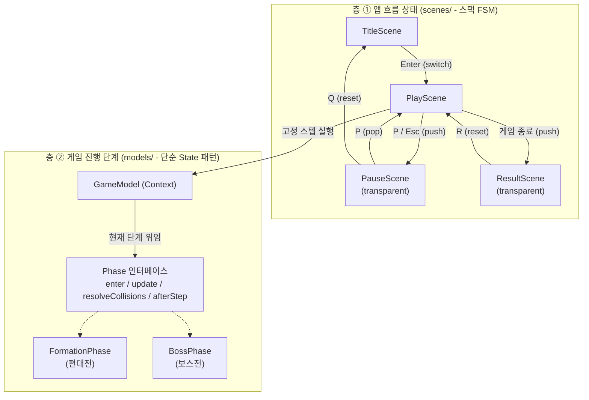

# 5일차(5주차) 학습 보고서 — State 패턴: 씬 전환(스택 FSM) + 진행 단계 분리 및 동등성 증명

> **학습 주제:** 화면 흐름(타이틀·플레이·일시정지·결과)과 게임 진행 단계(편대전·보스전)를 **State 객체**로 분리하고, 리팩터링 전후 동작이 1스텝도 달라지지 않았음을 **동등성 테스트(`equivalence_test`)**로 증명한다.  
> **대상 디렉터리:** [`lua_tuto/mvc/week05/`](README.md)

---

## 1. 학습 목표 및 4주차 숙제 회수

1. **State 패턴의 3요소 이해:** 상태 객체(`FormationPhase`, `BossPhase`), 컨텍스트(`GameModel`), 상태 전환 책임을 구조화한다.
2. **두 층의 상태 구분:** 앱 흐름 상태(`scenes/`: 비결정적, 입력 반응)와 게임 규칙 단계(`models/`: 결정적, 테스트/리플레이 대상)를 절대 섞지 않는다.
3. **단순 FSM vs 스택 FSM(Pushdown Automaton):** `SceneStack`의 `push`/`pop`/`switch`/`reset`을 직접 구현하여, Model 수정 없이 일시정지와 투명 결과 오버레이를 구현한다.
4. **순환 `require` 차단:** `ctx.scenes` 의존성 주입을 통해 씬끼리의 상호 참조(`Title → Play → Result → Title`)를 제거한다.
5. **리팩터링 동등성 증명:** 4주차 `GameModel`과 5주차 `GameModel`을 나란히 돌려 매 스텝 상태와 이벤트 순서가 100% 일치함을 검증한다.

| 4주차에 남긴 숙제 | 5주차 해결 결과 |
| :--- | :--- |
| `GameModel`에 변경 집중 (25 hunk 중 12) | 보스 규칙을 `BossPhase.lua`로 분리 → `GameModel` 내 보스 관련 코드 **25줄 → 3줄** |
| 재시작 로직이 `InputController`에 분기로 혼재 | 화면 흐름 키(`R`, `Esc`, `P`, `Q`)를 각 씬으로 이관, `InputController`는 순수 게임플레이 입력만 담당 |
| 일시정지 기능 부재 | `PauseScene` 스택 `push/pop`으로 Model 무수정 일시정지 구현 (`acc` 누적 정지 포함) |
| 리팩터링 전후 동일성 검증 | `equivalence_test`로 7개 시나리오(647~1,511스텝) 매 스텝 완벽 일치 증명 |

---

## 2. 핵심 아키텍처: 두 층의 상태 분리



### 2-1. 두 층의 상태를 섞으면 안 되는 이유
| 구분 | 앱 흐름 상태 (Scene) | 게임 진행 단계 (Phase) |
| :--- | :--- | :--- |
| **예시** | 타이틀 · 플레이 · 일시정지 · 결과 | 편대전 · 보스전 |
| **위치** | `scenes/` (조립 계층) | `models/` (도메인 규칙 계층) |
| **`love`/화면 인식** | 흐름은 알지만 `love`는 `ctx` 주입으로만 접근 | 전혀 모름 (순수 Lua 로직) |
| **결정성 필요 여부** | 아니오 (사람의 앱 조작 반응) | **예** (리플레이 · 동등성 테스트 대상) |
| **전환 계기** | 사용자 키 입력 (`P`, `R`, `Enter`) | 게임 내 규칙 조건 (`score >= 1000`) |

> **핵심 통찰:** 일시정지(`Pause`)를 `GameModel` 내부의 `state = "paused"`로 구현하면 모든 규칙 함수마다 일시정지 예외 분기를 넣어야 한다. 반대로 씬 스택에서 `PauseScene`을 위에 `push`하면 맨 위 씬만 `update()`를 받으므로 **Model은 자신이 멈췄는지조차 모른 채 완벽하게 일시정지된다.**

---

## 3. 스택 FSM(`SceneStack`) 및 `ctx` 설계

### 3-1. 스택 연산과 콜백 규약
- **`push(scene)`:** 기존 top 씬에 `pause()` 호출 → 새 씬에 `scene.stack = self` 주입 후 `enter()` 호출 (예: `Play → Pause`, `Play → Result`).
- **`pop()`:** 맨 위 씬에 `exit()` 호출 후 제거 → 드러난 아래 씬에 `resume()` 호출 (예: `Pause → Play`).
- **`switch(scene)`:** 맨 위 씬을 `exit()` 후 새 씬으로 교체 (`enter()`), 아래 씬은 유지 (예: `Title → Play`).
- **`reset(scene)`:** 스택의 모든 씬을 위에서부터 `exit()`로 비우고 새 씬을 `enter()` (예: `Pause → Title`, `Result → 새 Play`).
- **투명 그리기(`transparent = true`):** `draw()` 시 맨 위에서 아래로 내려가며 첫 불투명 씬을 찾은 뒤, 그 씬부터 위로 순서대로 그린다. 덕분에 `PauseScene`과 `ResultScene` 아래에 멈춘 마지막 게임 화면이 자연스럽게 비친다.

### 3-2. 순환 `require` 방지 (`ctx.scenes`)와 시드 생성(`newSeed`)
- 씬 파일끼리 `require("PlayScene")`, `require("ResultScene")`, `require("TitleScene")`을 직접 부르면 순환 참조로 모듈 로드에 실패한다. 따라서 조립부(`main.lua`)가 `ctx.scenes` 테이블에 모든 씬을 담아 한 번에 주입한다.
- `os.time()`은 초 단위이므로 1초 내에 `R` 키로 재도전하면 동일한 판이 반복된다. `main.lua`는 판 번호를 섞은 `newSeed()`를 `ctx.seed`로 주입하여 결정성("같은 시드 → 같은 판")과 판마다 다른 다양성을 동시에 확보한다.

---

## 4. 진행 단계 분리 및 동등성(`equivalence_test`) 검증 결과

### 4-1. `GameModel` 위임 구조
```lua
-- GameModel:update(dt, input) 내부 흐름 (4주차와 호출 위치 100% 동일)
self:_updateFormation(dt)
self:_updateEnemyFire(dt)
self.phase:update(self, dt)        -- 단계 위임: 보스 전환 체크 or 보스 이동/탄막
-- 적 총알 이동
self:_resolveCollisions()          -- 공통 충돌: 일반 적/플레이어
self.phase:resolveCollisions(self) -- 단계 위임: 총알 × 보스, 승리 판정
self.phase:afterStep(self)         -- 단계 위임: 편대 전멸 시 재생성
```

### 4-2. 테스트 스위트 실행 결과 (완성본 검증)
`lua_tuto/mvc/week05/examples/tests/`에서 직접 실행하여 검증한 결과:

| 테스트 파일 | 검사 항목 | 실행 결과 | 주요 검증 내용 |
| :--- | :--- | :---: | :--- |
| `layer_check.lua` | `galaga_states/` 26개 파일 | **위반 0건 (OK)** | 씬 `love` 금지, 씬 간 `require` 금지, Controller→Scene 금지 |
| `scene_test.lua` | 스택·씬 전환·일시정지·결과 | **16 통과 / 0 실패** | 콜백 순서, 투명 렌더링, 일시정지 시 시간(`acc`) 정지, 결과 1회 push |
| `phase_test.lua` | 단계 전환·경계·정적 검사 | **9 통과 / 0 실패** | 격파 스텝 총알 3발 동시 명중(경계), `BonusPhase` 무수정 끼워넣기 |
| `equivalence_test.lua` | 4주차 vs 5주차 매 스텝 비교 | **8 통과 / 0 실패** | 7개 시나리오(647~1,511스텝) 상태·RNG·이벤트 순서 일치 + 범위 점검 |

> **무작위 비교와 경계 단위 테스트의 상호 보완:**  
> `equivalence_test`는 7개 판을 끝까지(보스전, 승리, 게임오버 포함) 비교하지만, "보스 격파 스텝에 총알 2발 이상이 동시에 맞는 희귀한 상황"은 무작위 플레이에서 거의 나오지 않아 격파 후 `break` 누락 버그를 못 잡을 수 있다. 이를 **`phase_test`의 경계 단위 테스트**가 보완함으로써 두 테스트가 서로를 완벽히 메워준다.

---

## 5. 실측 비교: 4주차(`galaga_mvc_full`) vs 5주차(`galaga_states`)

| 측정 지표 | 4주차 (`galaga_mvc_full`) | 5주차 (`galaga_states`) | 변화 및 해석 |
| :--- | :---: | :---: | :--- |
| `GameModel.lua` 줄 수 | 295줄 | **255줄** (+`FormationPhase` 43 · `BossPhase` 54) | 보스전과 편대전 규칙이 독립 파일로 분리됨 |
| `GameModel` 내 보스 관련 줄 | **25줄** | **3줄** | `_steerMissiles` 표적 선정 및 `reset`의 `boss = nil`만 잔존 |
| 화면 흐름 키 담당 | `InputController`, `main` | **씬 4개** (각 씬이 자기 키만 소유) | `InputController`는 `game` 참조조차 필요 없어짐 |
| 일시정지 기능 | 없음 | **있음** (Model 수정 0줄) | `SceneStack`의 `push`/`pop`으로 자연스럽게 해결 |
| 새 씬 추가 비용 (`HelpScene`) | — | 새 파일 2개(`Scene`, `View`) + `main` 1줄 + `Title` 2줄 | 기존 씬·Model·Controller **0줄 수정**, `scene_test` 16/16 통과 |

### 정직한 해석 (State 패턴이 풀지 못한 것)
- **여전히 남은 3줄의 이유:** `GameModel`에 남은 보스 관련 3줄(유도 미사일의 보스 표적 선정)은 "진행 단계"가 아니라 **"어떤 엔티티가 표적이 될 수 있는가"**라는 엔티티 축의 문제다. 하나의 패턴이 모든 결합을 해결하지 못하며, 이는 엔티티/컴포넌트(ECS)나 중앙 Store 영역에서 다룬다.
- **전체 코드량 증가:** `GameModel + Phase` 합산 352줄(기존 295줄) 및 `scenes/` 계층이 신설되었다. State 패턴의 목적은 줄 수 감소가 아니라 **새 상태/씬 추가 시 기존 코드를 건드리지 않는 격리**다.

---

## 6. 흔한 실수 & 디버깅 포인트

| 실수 | 발생하는 문제 | 올바른 해결 방향 |
| :--- | :--- | :--- |
| 일시정지를 Model 상태로 구현 | 모든 게임 규칙에 `if paused` 분기가 퍼짐 | `SceneStack`에서 맨 위 씬만 `update()` 호출 |
| 재개 시 멈춘 동안의 `dt`를 한꺼번에 누적 | 일시정지 해제 순간 수백 스텝이 돌아 순간이동 발생 | 일시정지 중에는 `PlayScene:update` 자체가 안 불려 `acc` 미누적 |
| `push()` 시 `scene.stack = self` 누락 | 씬 내부에서 `self.stack:push(...)` 호출 시 `nil` 인덱싱 에러 | `SceneStack:push` / `switch` / `reset` 시 `scene.stack = self` 자동 바인딩 |
| 투명 씬 탐색을 스택 바닥부터 시작 | 불투명 씬 아래의 `Title`까지 전부 그려져 배경이 깨짐 | 스택 맨 위(`#stack`)에서 아래로 내려가며 첫 불투명 씬까지만 탐색 후 정순 그리기 |
| 단계 전환 스텝에서 새 단계 `update` 누락 | 4주차 대비 1/60초(1스텝) 차이로 리플레이/동등성 테스트 불일치 | `FormationPhase`에서 전환 직후 동일 스텝에 `boss:update` 일치 여부 검증 |

---

## 7. 핵심 개념 퀴즈 및 해설

1. **State 패턴의 상태 객체와 컨텍스트(Context), 그리고 공통/상태별 규칙 위치는?**  
   - **상태 객체:** `FormationPhase`, `BossPhase` (씬 층에서는 `TitleScene`, `PlayScene`, `PauseScene`, `ResultScene`).  
   - **컨텍스트:** `GameModel` (씬 층에서는 `SceneStack`).  
   - 공통 규칙(플레이어 이동, 총알 이동, 일반 충돌)은 컨텍스트(`GameModel`)에 두고, 단계별 특수 규칙(편대 재생성, 보스 이동/탄막/피격)은 각 상태 객체에 둔다.
2. **일시정지를 단순 FSM이 아닌 스택 FSM으로 구현할 때의 이점은?**  
   - 단순 FSM은 `Play → Pause` 전환 시 `Play` 객체가 소멸해 게임 상태를 별도로 직렬화/복원해야 한다. 스택 FSM은 `Play`를 아래에 그대로 살려 둔 채 `Pause`만 위에 `push`하고, `pop`하면 즉시 이어서 진행할 수 있다.
3. **일시정지가 Model의 진행 단계가 아니라 씬이어야 하는 이유 (결정성 관점)?**  
   - 진행 단계는 결정성이 필수인 게임 규칙(리플레이·시뮬레이션 검증 대상)이지만, 일시정지는 사람의 앱 조작(흐름)이다. 씬으로 분리해야 Model이 일시정지를 몰라도 되고 결정적 시뮬레이션이 오염되지 않는다.
4. **`ctx.scenes` 주입이 없으면 무슨 문제가 생기는가?**  
   - 씬끼리 서로 `require`하게 되어 `Title → Play → Result → Title` 순환 의존성 에러가 발생하며, 테스트 시 가짜 씬으로 대역을 교체하기도 어려워진다.
5. **`equivalence_test`가 보스전 포함 여부까지 범위 검사하는 이유는?**  
   - 편대전 구간만 비교하면 `BossPhase`가 비어 있거나 잘못 짜여도 테스트가 통과할 수 있다. 비교 시뮬레이션이 실제로 보스전, 승리, 게임오버, 다양한 플레이를 모두 거쳤는지 커버리지를 자체 검증해야 신뢰할 수 있다.
6. **`GameModel`에 남은 보스 관련 3줄이 State 패턴으로 지워지지 않는 이유는?**  
   - 유도 미사일 표적 탐색(`_steerMissiles`)은 "현재 어떤 단계인가"가 아니라 "표적이 될 수 있는 엔티티 목록이 무엇인가"라는 다른 축의 문제이기 때문이다.

---

## 8. 4항목 회고 루브릭 (4주차 vs 5주차 변화)

| 평가 항목 | 4주차 MVC | 5주차 State + MVC | 변화 근거 |
| :--- | :---: | :---: | :--- |
| **가독성·유지보수** | 4점 | **5점** | `GameModel` 보스 코드 25→3줄, 씬/단계 추가 시 기존 코드 수정 극소화 |
| **디버깅 용이성** | 5점 | **5점** | `equivalence_test`가 불일치 발생 스텝과 필드까지 정확히 지목 |
| **테스트 가능성** | 5점 | **5점** | `scene_test`(16)·`phase_test`(9)·`equivalence_test`(8) + 기존 회귀 테스트 전부 헤드리스 통과 |
| **AI 컨텍스트 밀도** | 5점 | **5점** | 보스 수정은 `BossPhase.lua` 단일 파일, 씬 수정은 해당 `*Scene.lua` 단일 파일만 전달 가능 |

